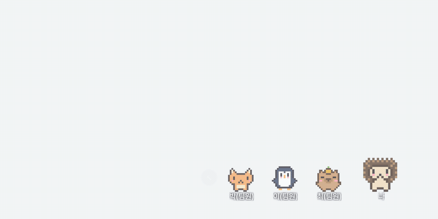

# 🐾 팀 펫

**작업표시줄 위의 작은 동물들로 대화하는 팀 메신저.** 심심하면 동료를 골대에 날려 넣으세요.

같은 방 사람마다 동물이 한 마리씩 화면 아래에 앉아 있고, 누가 말하면 그 동물 위에 말풍선이 떠요.
브라우저도, 계정도, 클라우드도 없이 같은 사무실 네트워크 안에서만 돌아갑니다.




## 할 수 있는 것

**대화**
- 💬 동물을 누르면 작은 대화창 — `@이름` 으로 부르기, 사진 붙여 넣기
- ✉️ 쪽지 — 한 사람에게만, 받은 사람 PC 에만 남아요
- 🎆 채팅 효과 — `/폭죽` `/박수` `/하트` `/ㅋㅋ` `/춤` `/비` `/눈` `/우산` `/눈사람`

**장난**
- 🦶 **날려버리기** — 동료 동물을 오른쪽 클릭 → 각도와 힘을 맞춰 날려요. 🏀 농구 골대나 ⛳ 골프 홀컵이 같이 나와서, 링·백보드 맞고 들어가기도 하고 굴러서 홀인하기도 해요. 너무 세게 차면 🚀 우주로.
- ❄️ **눈덩이** — 맞으면 잠깐 그 동물의 눈사람이 돼요. 날아오는 게 보이면 내 펫을 눌러 피할 수 있어요.


**같이 하는 게임**
- 🖍 캐치마인드 (단어 770여 개 + 가끔 2점짜리 어려운 문제) · 🎨 이어 그리기 (3문제)
- 🚇 지하철 레이스 · 🏗 높이 쌓기 · 💣 폭탄 돌리기 · 🔤 끝말잇기 · 🕵️ 라이어 게임
- ⚔️ 1:1 대결 (결투 · 러시안 룰렛 · 가위바위보) · 🏆 혼자 기록 도전 (방 TOP 3)

**낚시**
- 🎣 물고기 259종 도감 (상상 속 전설 포함) · 낚싯대 15단계 ⚒️ 강화 · 🏁 2분 낚시대회와 시상대

**동물 35종**, 🙈 `Ctrl+Alt+Z` 로 한 번에 숨기기, 알림 끄기, 진하기(투명도) 조절.
Windows 와 맥에서 똑같이 놀 수 있어요.

## 시작하기 (3단계)

1. **방장 한 명이 설치**하고 방을 만들어요. 그 PC 가 방의 서버가 돼요.
2. 펫이 알려 주는 **참가 링크**를 팀원에게 보내요. 형식은 `http://방장PC주소:4322/?code=…` 예요.
3. 팀원은 설치하고 **참가 링크를 붙여 넣으면** 끝. 이름과 동물은 펫이 물어봐요.

처음 설정부터 방 만들기, 참가 링크 복사까지 모두 펫 안에서 해요. 관리자 권한도 필요 없어요.

## 설치

[Releases](https://github.com/kimdonghuyn/team-pet/releases/latest) 에서 받아요.

| 파일 | 누가 |
|---|---|
| `TeamPet-Setup.exe` | Windows |
| `TeamPet-Portable.zip` | Windows 에서 설치 파일이 막힐 때 — 풀고 `setup.cmd` |
| `TeamPet-mac-arm64.dmg` | 맥 (Apple 칩, M1 이후) |
| `TeamPet-mac-x64.dmg` | 맥 (Intel) |

**맥에서 처음 열 때** — 애플 개발자 인증서로 서명하지 않은 앱이라 두 가지가 필요해요.
1. 앱을 응용 프로그램 폴더에 넣고 터미널에서 한 번:
   `xattr -dr com.apple.quarantine /Applications/TeamPet.app`
2. 처음 켤 때 **"로컬 네트워크의 기기에 연결하도록 허용"** 을 물으면 **허용**. (방장 PC 에 연결하는 데 필요해요)

자세한 사용법은 [사용-설명서.md](사용-설명서.md) 에 있어요.

## 알아 둘 것

- **같은 네트워크 전용이에요.** 팀원은 방장 PC 에 직접 연결해요. 재택·원격 팀은 같은 네트워크(VPN 등)로 묶여 있어야 해요.
- **방장 PC 가 켜져 있어야** 방이 열려 있어요.
- 대화는 방장 PC 의 메모리에만 있고 파일로 남지 않아요. 쪽지는 받는 사람 PC 에만 남아요.
- 새 버전이 나오면 펫이 알려 줘요. Windows 는 **[지금 업데이트]** 버튼 하나로 바뀌고, 맥은 **[받기]** 를 눌러 새 dmg 로 덮어써요.
- 팀원이 연결되지 않으면 방장 PC 의 방화벽을 한 번 열어 주세요 — [사용-설명서.md 의 문제 해결](사용-설명서.md#8-문제-해결) 에 명령이 있어요.

## 어떻게 이어지나

```
 방장 PC (허브)                         팀원 PC
 ┌──────────────────┐  같은 네트워크   ┌──────────────────┐
 │ 팀 펫 :4322        │ ◀─────────────▶ │ 팀 펫 :4322        │
 │ 방 · 참가 코드     │   (방 키, 헤더)   │ 바탕화면 펫        │
 │ 대화 · 게임 판정   │                 │                  │
 └──────────────────┘                 └──────────────────┘
```

게임과 낚시의 판정(누가 이겼는지, 무엇이 낚였는지, 골인지)은 모두 방장 PC 가 해요. 그래서 모두의 화면에 같은 장면이 나와요.

## 개발

```bash
npm install
node server/index.js --hub          # 방장으로 켜기 (설정: ~/.team-pet/config.json)
node server/index.js --push-config  # 팀원으로 켜기
npm test                            # 테스트
node scripts/pack.js                # Windows 압축판 · 설치 파일 → dist/
```

- `server/index.js` — 방장·팀원 서버 (HTTP)
- `server/pet.ps1` · `server/pet.js` — Windows 바탕화면 펫 (WPF 를 PowerShell 로 띄워서 따로 설치할 것이 없어요)
- `client/pet*.js` — 맥 앱의 웹 펫 (`mac/main.cjs`, Electron)
- `server/team.js` — 방 · 대화 · 쪽지 · 찌르기
- `server/party.js` · `relay.js` · `duel.js` · `records.js` · `fish.js` · `smack.js` · `subway.js` — 게임과 낚시 (방장이 판정)

맥 앱은 `v*` 태그를 올리면 GitHub Actions 의 맥 빌드 서버가 만들어 그 릴리스에 붙여요 (`.github/workflows/mac.yml`).

## 라이선스

MIT
